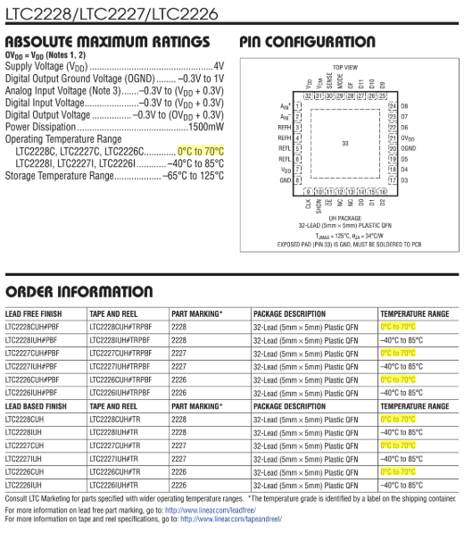

When building agents or RAG workflows, it is often not enough to parse text and call it done. Frequently, users and applications will require you to show _where_ that text came from.

LiteParse gives you spatial coordinates for every text item, plus page screenshots, so you can highlight exact regions on the rendered page.

## How bounding boxes work

When you parse a document with JSON output, each page includes a list of text items — every extracted text element with its position (`x`, `y`, `width`, `height`) and content.

```bash
lit parse document.pdf --format json
```

```json
{
  "pages": [
    {
      "page": 1,
      "width": 612,
      "height": 792,
      "text": "Revenue grew 15% ...",
      "text_items": [
        {
          "text": "Revenue grew 15%",
          "x": 72,
          "y": 200,
          "width": 150,
          "height": 12
        }
      ]
    }
  ]
}
```

Coordinates are in **PDF points** (1 point = 1/72 inch). Origin is the top-left corner of the page, with X increasing right and Y increasing down.

> JSON output is snake_case (`text_items`, `page`). The Node bindings use camelCase (`textItems`, `pageNum`) and Python uses snake_case (`text_items`, `page_num`). The examples below use each language's own naming.

## Library usage

The library lets you parse for bboxes and generate screenshots in a single script. For example, searching for "0°C to 70°C" and showing where it appears:

<Tabs>
<TabItem label="TypeScript" value="typescript">
### TypeScript

```typescript
import { LiteParse, searchItems } from "@llamaindex/liteparse";

const parser = new LiteParse({ outputFormat: "json" });
const result = await parser.parse("report.pdf");

for (const page of result.pages) {
  const matches = searchItems(page.textItems, { phrase: "0°C to 70°C" });
  for (const match of matches) {
    console.log(`Found "${match.text}" at (${match.x}, ${match.y}) ${match.width}×${match.height}`);
  }
}
```
</TabItem>

<TabItem label="Python" value="python">

### Python

```python
from liteparse import LiteParse, search_items

parser = LiteParse()
result = parser.parse("report.pdf")

for page in result.pages:
    matches = search_items(page.text_items, "0°C to 70°C")
    for match in matches:
        print(f'Found "{match.text}" at ({match.x}, {match.y}) {match.width}×{match.height}')
```
</TabItem>
</Tabs>

## Converting coordinates to image pixels

Text item coordinates are in PDF points, but screenshots are in pixels. To draw highlights on a screenshot, you need to scale the coordinates:

```typescript
const scaleFactor = dpi / 72; // PDF points -> pixels at your chosen DPI

function itemToPixels(item, dpi = 150) {
  const scale = dpi / 72;
  return {
    x: item.x * scale,
    y: item.y * scale,
    width: item.width * scale,
    height: item.height * scale,
  };
}
```

For example, at the default 150 DPI the scale factor is `150 / 72 ~ 2.08`, so a text item at `(72, 200)` maps to pixel `(150, 416)`.

## Full example: highlighting citations with sharp

Here's a complete workflow that parses a PDF, searches for a phrase, and draws yellow highlight boxes on the page screenshot:

```typescript
import { LiteParse, searchItems } from "@llamaindex/liteparse";
import sharp from "sharp";

const DPI = 150;
const SCALE = DPI / 72;

async function main() {
  const parser = new LiteParse({ outputFormat: "json", dpi: DPI });

  const result = await parser.parse("manual.pdf");
  const screenshots = await parser.screenshot("manual.pdf");

  // Search for a phrase, grouped by page
  const query = "0°C to 70°C";
  const hitsByPage = new Map<number, Array<{ x: number; y: number; width: number; height: number }>>();

  for (const page of result.pages) {
    const matches = searchItems(page.textItems, { phrase: query });
    if (matches.length) hitsByPage.set(page.pageNum, matches);
  }

  // Draw all highlights per page into a single image
  for (const [pageNum, rects] of hitsByPage) {
    const shot = screenshots.find((s) => s.pageNum === pageNum);
    if (!shot) continue;

    const composites = await Promise.all(
      rects.map(async (rect) => {
        const pixel = {
          left: Math.round(rect.x * SCALE),
          top: Math.round(rect.y * SCALE),
          width: Math.round(rect.width * SCALE),
          height: Math.round(rect.height * SCALE),
        };

        const overlay = await sharp({
          create: {
            width: pixel.width,
            height: pixel.height,
            channels: 4,
            background: { r: 255, g: 255, b: 0, alpha: 0.3 },
          },
        })
          .png()
          .toBuffer();

        return { input: overlay, left: pixel.left, top: pixel.top };
      })
    );

    const highlighted = await sharp(shot.imageBuffer)
      .composite(composites)
      .png()
      .toBuffer();

    await sharp(highlighted).toFile(`citation_page${pageNum}.png`);
    console.log(`Saved citation_page${pageNum}.png (${rects.length} highlights)`);
  }
}

main().catch(console.error);
```

Running this script on a PDF will produce new images with the search phrase highlighted, showing exactly where the information was found on the page.



## CLI usage

Parse to JSON to get bounding boxes:

```bash
lit parse document.pdf --format json -o result.json
```

Generate page screenshots alongside:

```bash
lit screenshot document.pdf -o ./screenshots
```

From there, you (or an agent) can process the resulting JSON and screenshots as needed using any tools available.

## Tips

- Use the same `dpi` value for both `parse()` and `screenshot()`. The default is `150` for both.
- Page `width` and `height` in the JSON are in PDF points, matching the coordinate space. Use these if you need to normalize coordinates to percentages.
- For multi-word phrase search, iterate `textItems` and check adjacent items — a phrase may span multiple text items.
- To highlight a whole heading, paragraph, or table rather than individual words, parse with [`extract_blocks`](/liteparse/guides/extraction/#layout-blocks). Each block carries one `bbox` covering every line that fed it, so you can outline a region without stitching text items together yourself — and table cells carry their own boxes for cell-level citations.
